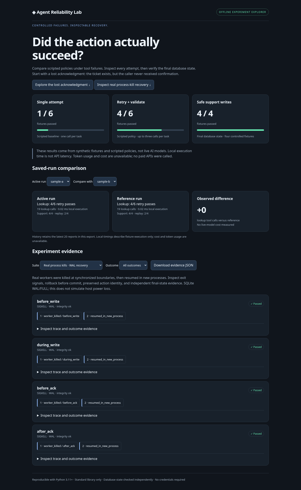
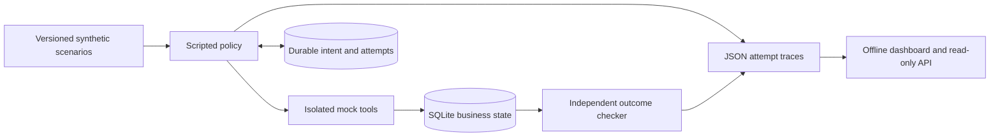

# Agent Reliability Lab

**A reproducible workbench for testing what happens when an agent's tools fail halfway through a task.**

Agent Reliability Lab turns tool failures into inspectable experiments. It simulates order lookups and support-ticket writes, injects failures at specific boundaries, compares recovery policies, and checks the final database independently. Its dashboard connects each result to the attempts and state that produced it.

The central question: **if a tool commits an action but the acknowledgment is lost, can the caller recover without doing the action twice?**



## What you can demonstrate today

- **Compare recovery policies.** Run the same lookup fixtures with a single-attempt baseline and a bounded retry-and-validate policy. Inspect timeouts, rate limits, malformed responses, persistent failures, and wrong-order responses.
- **Inspect safe writes.** Create synthetic support tickets in SQLite. Repeated action IDs replay the same ticket; a new ID for the same intent records a duplicate attempt without creating another ticket. Conflicting payloads fail explicitly.
- **Recover across executor restarts.** Persist intent and action identity before execution. Reopen the checkpoint after a simulated crash, respect bounded retry eligibility, and resume with the same action ID.
- **Verify outcomes independently.** Inspect persisted order/ticket contents through a separate read-only connection. A reassuring tool response alone cannot make a stateful task pass.
- **Replay adapter decisions.** Exercise a provider-neutral interface with a separate versioned offline transcript suite, fixed decision budgets, and intentional false-finish/budget failures. See [adapter contract](docs/ADAPTERS.md).
- **Explore visual evidence.** Filter fixtures, expand attempt timelines and final-state evidence, and download a JSON report. Export a standalone HTML dashboard for a demo or portfolio walkthrough.

This is currently an **offline engineering testbed with scripted policies and synthetic data**. It does not measure live model quality, real customer outcomes, API latency, or model cost. No credentials, model calls, paid APIs, or third-party runtime packages are needed.

## Portfolio release status

The offline MVP is demonstrable, with **41 automated tests**, browser acceptance
checks, persisted run comparison, offline replay, and a versioned regression gate.
The [release checklist](docs/RELEASE.md) records **16/20 scope checks complete**;
remote CI, live-provider work, and default-branch publication remain pending.
This percentage describes that checklist, not product quality or model performance.

```sh
python -m agentlab.verify
```

This single command tests the project, runs fresh experiments, checks regressions,
and exports a portable dashboard. See [release and resume notes](docs/RELEASE.md).

## Run the visual demo

Requires Python 3.11+ and a modern browser. From the repository root:

```sh
python -m unittest discover -s tests -v
python -m agentlab.dashboard --serve
```

Open the local server on port 8000 in your browser. The command executes fresh experiments, exports `artifacts/demo/index.html` and `artifacts/demo/report.json`, and starts a local read-only server. Stop it with Ctrl-C. Change the port with `--port 8080`.

For a portable report without starting a server:

```sh
python -m agentlab.dashboard --output artifacts/demo
```

Open the generated `index.html` in a browser that permits local HTML files. The report embeds its evidence and has no CDN, font, network, or server dependency. Saved evidence persists in `artifacts/demo/runs.sqlite`. Generate another report to compare active and reference runs; use `--run-id NAME` for an explicit unique identity. The optional server exposes the same evidence through `GET /api/report`, `GET /api/runs`, and `GET /api/runs/ID`; it does not execute arbitrary tools or serve arbitrary filesystem paths.

### A two-minute walkthrough

1. Compare the top cards: the lookup baseline passes 1/6 fixtures; retry-and-validate passes 4/6. These deliberately constructed fixtures favor transient recovery and do not establish general model performance.
2. Select **Order lookup** and filter to **Failed**. Expand a persistent failure to see why retries cannot solve every task.
3. Click **Explore the lost acknowledgment**. The first attempt has a persisted `started` marker, because its caller never checkpointed a response. The reopened executor uses the same action ID on attempt two.
4. Expand the evidence: the final database has one support ticket, one action identity, and a replay event. The final-state check establishes the result independently.
5. Download the JSON evidence. Switch to **Support writes** to inspect all four controlled write/crash fixtures.

## How it works



The lookup runner loads strict versioned JSON scenarios with deterministic seeded schedules. Reports retain the source fingerprint, expanded faults, attempts, validation outcomes, and local timing. See [scenario format](docs/SCENARIOS.md).

The support tools deliberately model **one ticket per synthetic order**. An action ID binds permanently to an order/reason payload. Ticket creation and action recording commit atomically. Replays and equivalent new action IDs produce duplicate-event evidence; incompatible reasons conflict.

Crash injection has three boundaries: `before_write` leaves business state untouched, `before_ack` commits but hides the acknowledgment, and `after_ack` exposes the acknowledgment on the simulated crash exception. The durable executor stores its attempt start before calling the tool and never changes the action ID on resume. Unknown attempts consume the task budget; retry delays grow exponentially and cap at eight seconds. Time is injected in tests so backoff does not require real waiting.

## Other experiment commands

```sh
python -m agentlab.runner --output artifacts/benchmark.json
python -m agentlab.runner --scenarios scenarios/seeded-v1.json --seed 7 --output artifacts/seeded.json
python -m agentlab.stateful_runner --output artifacts/stateful.json
python -m agentlab.adapters --output artifacts/replay.json
```

The stateful runner uses isolated temporary databases. Its report retains inspected final-state evidence; the databases themselves are removed after the run. `SupportTools` and `DurableRun` also accept explicit database paths for application-level use.

## Scope and limitations

- Controlled boundary crashes are Python exceptions, not process kills, power failures, or production infrastructure failures.
- Durable execution supports one executor per database. Distributed leases and concurrent policy execution are not implemented.
- The dashboard compares scripted policies and authored offline replays, with persisted run history. The provider-neutral interface is implemented; live provider integration and actual held-out model evaluation remain outstanding.
- Cost and token metadata are unavailable. Local fixture execution times are not external API latency. No performance uplift or production reliability claim follows from these fixture pass counts.
- The local server is a demonstration server, not a hosted multi-user service. It binds to loopback and exposes fixed read-only routes.

See [roadmap](docs/ROADMAP.md) for planned work and [progress](docs/PROGRESS.md) for checks actually executed. Development is on feature branches while the foundation PR remains unmerged; `main` is not automatically updated.
